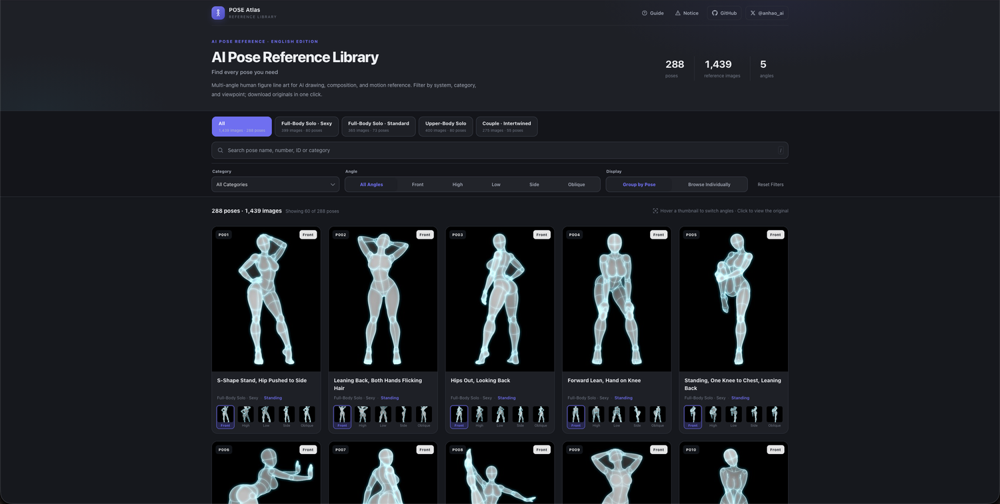

# AI Pose Gallery · English Edition

> 288 pose groups / 1,439 AI human-pose reference images. Japanese metadata fully localized into English, with a deploy-ready responsive static gallery.



<details><summary>Mobile preview</summary>


</details>

**Live demo:** <https://ai-pose-gallery.anhao.app/>
**Original site:** <https://ai-pose-gallery.pages.dev/>
**Original author:** ギア (@giaaibusi)
**Chinese edition:** Anhao · [X @anhao_ai](https://x.com/anhao_ai)
**GitHub (Chinese edition):** <https://github.com/anhao/ai-pose-gallery-zh>

---

## What this is

The original site is a pose reference library for AI drawing / 3D / photography, with all metadata in Japanese and no bulk asset download. This repository does three things:

1. **Full mirror** — all 1,439 records' 1,439 thumbnails (JPG 300×400) and 1,439 full images (PNG 900×1200), 2,878 files / 659.5 MB total.
2. **Complete English localization** — Japanese fields translated one by one into English, covering 4 systems, 26 categories, 288 pose names, and 5 viewpoints, with no omissions.
3. **A working frontend** — a zero-dependency responsive gallery that fully implements the original site's category filtering, multi-angle switching, grouped browsing, lightbox navigation, and full-image download, with a layout redesigned for mobile.

## Page features

- 4 system tabs, each showing its image count and pose-group count
- Search by pose name, number, ID, or category keyword, with `/` to focus the search box
- Combined filtering by action category and 5 viewpoints, with one-click reset
- **Group-by-pose / browse-one-by-one** dual mode; group cards carry multi-angle thumbnails
- Hover or click a thumbnail to switch the main image's angle; click a card to open the lightbox
- The lightbox shows the thumbnail first, then loads the 900×1200 full image; supports direct PNG download, ID copy, and open-in-new-window
- `← / →` switch angle, `↑ / ↓` switch pose, `Esc` close; swipe left/right on mobile
- Multi-column grid on desktop, two-column grid on mobile; collapsible filter panel on mobile
- Usage-guide and notes dialogs; footer credits the image source and maintainer links

## SEO & sharing

The page ships with full SEO and social-sharing configuration:

- Keyword title: `AI Pose Reference Library | 288 Human Poses · 1,439 Multi-Angle Reference Images`
- Dedicated description, keywords, author, and `max-image-preview:large`
- `canonical` points at the official domain, avoiding duplicate indexing between the custom domain and the pages.dev domain
- Open Graph / Twitter Card use a 1200×630 `og-cover.jpg`
- JSON-LD structured data: `WebSite` + `ImageGallery`, declaring language, description, and the page's main image
- `robots.txt` allows the whole site and declares the sitemap; `sitemap.xml` points at the homepage
- Semantic structure: single H1, section H2s, card H3s; thumbnail `alt` text includes the pose name and viewpoint, images are lazy-loaded

Absolute URLs in the repo uniformly point to `https://ai-pose-gallery.anhao.app/`. If you fork and use a different domain, update the canonical, `og:*`, `twitter:*`, and JSON-LD in `index.html`, plus the addresses in `robots.txt` and `sitemap.xml`.

## Data scale

| System | Records |
| --- | ---: |
| Full-Body Solo · Standard | 365 |
| Full-Body Solo · Sexy | 399 |
| Upper-Body Solo | 400 |
| Couple · Intertwined | 275 |
| **Total** | **1439** |

Each record maps to one or more of the 5 viewpoints: Front / Oblique / Side / High / Low.

## Directory structure

```
.
├── index.html               # single-page gallery (zero dependencies, opens directly)
├── robots.txt               # search-engine crawl rules
├── sitemap.xml              # sitemap
├── og-cover.jpg             # 1200×630 social-share cover
├── data/
│   ├── pose.json            # original Japanese data (1439 records, unchanged)
│   ├── pose-zh.json         # Chinese data (intermediate, for reference)
│   ├── pose-en.json         # English data (frontend reads this; has search field)
│   ├── meta.json            # original system categories
│   ├── meta-zh.json         # Chinese system categories
│   ├── meta-en.json         # English system categories
│   ├── translations.csv     # JP⇄ZH lookup table (323 rows, for proofreading)
│   └── translations-en.csv  # ZH⇄EN lookup table
├── thumbs/                  # 1439 thumbnails, JPG 300×400 (22 MB)
├── img/                     # 1439 full images, PNG 900×1200 (637 MB)
├── scripts/
│   ├── download.py          # concurrent downloader (48 threads / resume / auto-retry)
│   ├── i18n.py              # JP→ZH dictionary (323 translations after de-dup)
│   ├── apply_translation.py # fills translations, generates Chinese data
│   ├── i18n_en.py           # ZH→EN dictionary (systems / categories / angles / pose names)
│   ├── apply_translation_en.py # fills EN translations, generates English data
│   ├── make_thumbs.py       # regenerates dark thumbnails from the full PNGs
│   ├── verify.py            # verifies file integrity (presence / size / image header)
│   └── build.sh             # generates the Cloudflare Pages dist/ publish directory
├── docs/                    # README page preview images
├── _headers                 # Cloudflare Pages caching policy
├── LICENSE
└── README.md
```

## Data structure

Field reference for `data/pose-en.json`:

| Field | Original JP field | Example | Description |
| --- | --- | --- | --- |
| `id` | — | `full_sexy_P001_front` | unique identifier |
| `system` | `系統` | Full-Body Solo · Sexy | 4 systems |
| `poseNumber` | `ポーズ番号` | `P001` | 80 pose numbers |
| `category` | `分類` | Standing | 26 action categories |
| `poseName` | `ポーズ名` | S-Shape Stand, Hip Pushed to Side | 288 descriptions |
| `angle` | `アングル` | Front | 5 viewpoints |
| `thumb` | `サムネ` | `thumbs/…jpg` | relative path |
| `full` | `原寸` | `img/…png` | relative path |
| `search` | — | concatenated string | for frontend fuzzy search |

The original Japanese data `data/pose.json` is left unchanged, with field names matching the site's API, for cross-referencing or backfilling. `data/pose-zh.json` is the Chinese intermediate kept for reference; `data/pose-en.json` is what the frontend actually loads.

## Local preview

The gallery reads JSON via `fetch`, which needs an HTTP environment (double-clicking `index.html` directly is blocked by CORS):

```bash
python3 -m http.server 8000
# open http://127.0.0.1:8000
```

The page supports system/category/viewpoint combined filtering, keyword search, grouped and one-by-one browsing, multi-angle thumbnails, lazy loading, lightbox full-image download, and keyboard/touch navigation.

## Script usage

```bash
# Re-pull all images (existing files are skipped, safe to re-run)
python3 scripts/download.py
WORKERS=64 python3 scripts/download.py   # adjust concurrency

# After editing translations in scripts/i18n.py, regenerate the Chinese data
python3 scripts/apply_translation.py
# After editing translations in scripts/i18n_en.py, regenerate the English data (frontend reads this)
python3 scripts/apply_translation_en.py

# Regenerate dark thumbnails from the full PNGs
python3 scripts/make_thumbs.py

# Verify all 2878 image files are complete
python3 scripts/verify.py
```

## Deploy to Cloudflare Pages

The repo is a pure static site, no framework, no dependencies.

**Option 1: automatic GitHub deployment (recommended)**

1. Log in to the Cloudflare Dashboard → **Workers & Pages** → **Create** → **Pages** → **Connect to Git**
2. Select this repository → production branch `main`
3. Use these build settings:

   | Field | Value |
   | --- | --- |
   | Framework preset | `None` |
   | Build command | `bash scripts/build.sh` |
   | Build output directory | `dist` |

4. **Save and Deploy** — in about 2–5 minutes you get `https://<project>.pages.dev`
5. Every subsequent `git push` redeploys automatically

> ⚠️ **Do not** set Build output directory to `/`. The repo root contains `.git` (hundreds of MB);
> Cloudflare scans it as static assets, and a pack file over the 25 MiB single-file limit fails the build.
> `scripts/build.sh` copies only `index.html`, `_headers`, `robots.txt`, `sitemap.xml`, `og-cover.jpg`, `data/`, `thumbs/`, `img/` to `dist/`.
> If you really want to use the root, the repo includes `.assetsignore` to exclude non-site files as a fallback.

> Site limits: single file ≤ 25 MiB, ≤ 20,000 files per deploy. This repo's largest file is 577 KB and it ships 2,891 files total — well within the limits.

**Option 2: direct CLI upload**

```bash
bash scripts/build.sh
npx wrangler pages deploy dist --project-name ai-pose-gallery
```

`_headers` sets a one-year strong cache for `img/` and `thumbs/`, so images won't be re-fetched.

## Content note

The library contains adult pose references (some category names involve sexual terminology). For artistic creation, motion reference, and frontend learning only. Do not use for unlawful purposes. No minors.

## Copyright & credits

- **The copyright of the images and original data belongs to the original author ギア**; the source address is at the top of the page
- This repo is only a personal archive for learning, localization, and static-site practice; it **claims no rights over the images** and does not constitute a license for commercial use of the original work
- If the original author believes this repo infringes their rights, please contact via Issue and the relevant content will be removed immediately
- The code in `scripts/` and `index.html` is open-sourced under the MIT license (see [LICENSE](LICENSE)); the license **does not cover** the images and original data in `img/`, `thumbs/`, and `data/`
